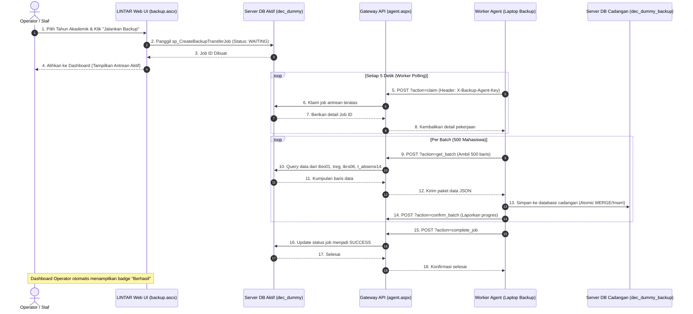
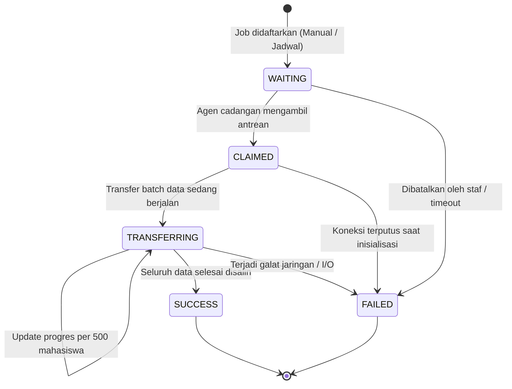

# DOKUMENTASI LENGKAP KODE PROGRAM
## Sistem Manajemen Backup & Pemulihan Data Historis Terdistribusi (LINTAR)

---

### DAFTAR ISI
1. [Pengantar & Filosofi Arsitektur Kode](#1-pengantar--filosofi-arsitektur-kode)
2. [Peta Struktur Berkas & Pembagian Modul](#2-peta-struktur-berkas--pembagian-modul)
3. [Fondasi Bersama (Shared Backend & Layout Layer)](#3-fondasi-bersama-shared-backend--layout-layer)
   - [3.1 Site.master (Kerangka Tampilan & Interaksi Pengguna)](#31-sitemaster-kerangka-tampilan--interaksi-pengguna)
   - [3.2 index.aspx & index.ascx (Pintu Gerbang & Pemuat Tab Dinamis)](#32-indexaspx--indexascx-pintu-gerbang--pemuat-tab-dinamis)
   - [3.3 con_backup.ascx (Pusat Logika & Koneksi Basis Data)](#33-con_backupascx-pusat-logika--koneksi-basis-data)
   - [3.4 table_helpers.ascx (Helper Pemetaan Tabel & Teks)](#34-table_helpersascx-helper-pemetaan-tabel--teks)
4. [Bedah Kode Per Modul Halaman](#4-bedah-kode-per-modul-halaman)
   - [4.1 Dashboard Utama (statistik.ascx)](#41-dashboard-utama-statistikascx)
   - [4.2 Backup Data Manual & Terjadwal (backup.ascx)](#42-backup-data-manual--terjadwal-backupascx)
   - [4.3 Pemulihan Data / Restore (pemulihan.ascx)](#43-pemulihan-data--restore-pemulihanascx)
   - [4.4 Ekspor Database ke File .BAK (ekspor.ascx)](#44-ekspor-database-ke-file-bak-eksporascx)
   - [4.5 Riwayat & Log Proses (riwayat.ascx)](#45-riwayat--log-proses-riwayatascx)
   - [4.6 Laporan Ringkasan & Generator PDF (summary_report.ascx & pdf_report_writer.ascx)](#46-laporan-ringkasan--generator-pdf-summary_reportascx--pdf_report_writerascx)
   - [4.7 Manajemen Pengguna & Hak Akses (operator.ascx)](#47-manajemen-pengguna--hak-akses-operatorascx)
5. [API Gateway Agen Background (api/agent.aspx)](#5-api-gateway-agen-background-apiagentaspx)
6. [Diagram Alir Interaksi Sistem (Mermaid)](#6-diagram-alir-interaksi-sistem-mermaid)
7. [Panduan Pemeliharaan & Pengembangan Lanjutan](#7-panduan-pemeliharaan--pengembangan-lanjutan)

---

### 1. PENGANTAR & FILOSOFI ARSITEKTUR KODE

Modul **`backup_data`** pada portal LINTAR Untar dibangun untuk mengatasi tantangan performa basis data akademik yang menyimpan jutaan baris rekaman selama puluhan tahun (data mahasiswa, registrasi semester, KRS, dan absensi perkuliahan).

#### Prinsip Utama Pemrograman:
1. **Pemisahan Tugas Bersih (*Separation of Concerns*):**
   Server web utama (IIS) tidak melakukan proses transfer basis data yang berat secara langsung, melainkan bertindak sebagai **pengendali antrean (*queue dispatcher*)** dan **penyaji antarmuka (*UI cockpit*)**. Beban I/O berat dikerjakan oleh agen latar belakang (*autonomous worker agent*).
2. **Modularitas Kontrol Web (*Dynamic Control Loading*):**
   Alih-alih membuat 7 halaman `.aspx` terpisah yang membebani memori dan mempersulit pemeliharaan, sistem menggunakan konsep **Single-Shell Architecture**. Halaman utama [`index.aspx`](file:///z:/lintar2022/backup_data/index.aspx) bekerja sama dengan [`index.ascx`](file:///z:/lintar2022/backup_data/index.ascx) untuk memuat modul yang sedang dibuka secara dinamis (*lazy loading*).
3. **Keamanan Bertingkat (*Defense in Depth*):**
   - Validasi sesi portal global via `cekauthlintarNew()`.
   - Pemeriksaan peran berbasis database (*Role-Based Access Control*) membedakan hak akses antara **Staf Operasional** dan **Manajer/Pimpinan**.
   - Token anti pemalsuan permintaan (*anti-CSRF postback token*) pada form ASP.NET.
   - Semua operasi database menggunakan **Parameterized Queries** dan **Stored Procedures** untuk menjamin keamanan dari serangan SQL Injection.

---

### 2. PETA STRUKTUR BERKAS & PEMBAGIAN MODUL

```
z:\lintar2022\backup_data\
├── Site.master                       -> Kerangka layout HTML induk (Header, Sidebar, JS, CSS)
├── index.aspx                        -> Titik masuk URL utama & pelindung sesi LINTAR
├── index.ascx                         -> Dispatcher penentu tab aktif (Dashboard/Backup/Restore/dll.)
├── style.css                         -> Lembar gaya CSS terpadu (Design System Maroon Untar)
├── web.config                        -> Konfigurasi runtime ASP.NET
│
├── ascx\                             -> Direktori Komponen Kontrol Halaman
│   ├── con_backup.ascx               -> Konfigurasi koneksi ADO.NET, peran & helper terpusat
│   ├── table_helpers.ascx            -> Helper fungsi pemetaan nama tabel & teks ramah pengguna
│   ├── statistik.ascx                -> Tab 1: Dashboard cockpit monitoring & verifikasi periode
│   ├── backup.ascx                   -> Tab 2: Konfigurasi backup manual & otomatis terjadwal
│   ├── pemulihan.ascx                -> Tab 3: Pemulihan data per Tahun Akademik atau per NIM
│   ├── ekspor.ascx                   -> Tab 4: Pembuatan arsip fisik file .BAK & verifikasi
│   ├── riwayat.ascx                  -> Tab 5: Riwayat proses terperinci dengan pagination
│   ├── summary_report.ascx           -> Tab 6: Laporan rekapitulasi data & filter periode
│   ├── pdf_report_writer.ascx        -> Mesin generator dokumen PDF native in-memory
│   └── operator.ascx                 -> Tab 7: Pengelolaan akses operator & hak akses peran
│
└── api\
    └── agent.aspx                    -> API Gateway komunikasi HTTP/JSON dengan Agen Eksternal
```

---

### 3. FONDASI BERSAMA (SHARED BACKEND & LAYOUT LAYER)

#### 3.1 Site.master (Kerangka Tampilan & Interaksi Pengguna)
Berkas [`Site.master`](file:///z:/lintar2022/backup_data/Site.master) menyediakan kerangka HTML induk bagi seluruh halaman aplikasi.
- **Integrasi Pustaka Antarmuka:** Memuat Bootstrap 3.3.6, AdminLTE Theme, Font Awesome 4.7, dan pustaka notifikasi modern **SweetAlert2**.
- **Komponen Notifikasi Ramah Pengguna:**
  - `window.backupNotice(message, icon)`: Menampilkan dialog peringatan ramah menggunakan tema Maroon Untar (`#A01626`).
  - `window.backupConfirm(button, message, options)`: Mencegah aksi tidak sengaja dengan menampilkan modal konfirmasi sebelum tombol ASP.NET melakukan *postback*.
- **Pre-loader Elegan:** Menggunakan komponen animasi `#lintar-loader` untuk memberikan umpan balik visual saat halaman sedang memproses data.

#### 3.2 index.aspx & index.ascx (Pintu Gerbang & Pemuat Tab Dinamis)
- **`index.aspx` (Otentikasi & Keamanan Form):**
  - Pada tahap `Page_OnInit`, sistem memanggil `cekauthlintarNew()` dari `/con_ascx2022/conlintar2022.ascx` untuk memastikan sesi pengguna LINTAR masih sah.
  - Pada tahap `Page_OnPreLoad`, sistem menghasilkan token unik `ViewState("BackupPostbackToken")` untuk memastikan form tidak dapat disubmit ulang secara tidak sah.
- **`index.ascx` (Lazy Loading Controller):**
  - Membaca parameter URL `Request.QueryString("tab")`.
  - Jika pengguna adalah **Manager**, akses ke tab operasional (`backup`, `pemulihan`, `ekspor`, `operator`) akan diblokir otomatis dan dialihkan ke dashboard dengan pesan peringatan.
  - Memanggil `LoadControl("ascx/" & modulTerpilih & ".ascx")` dan menempatkannya ke dalam `<asp:PlaceHolder ID="phModule">`. Mekanisme ini membuat halaman sangat ringan karena hanya berkas yang sedang dibuka yang dimuat ke memori server.

#### 3.3 con_backup.ascx (Pusat Logika & Koneksi Basis Data)
Berkas [`ascx/con_backup.ascx`](file:///z:/lintar2022/backup_data/ascx/con_backup.ascx) adalah otak dari pengelolaan data:
- **Adapter Koneksi Cerdas (`connstringLive`):**
  Membaca kredensial dari berkas warisan `/con_ascx2022/condecdummy.ascx` menggunakan `OleDbConnectionStringBuilder`, lalu mengubahnya secara otomatis menjadi format `SqlClient` murni dengan fitur *Connection Pooling* aktif. Hal ini membuat aplikasi sangat hemat koneksi dan berperforma tinggi.
- **Pengawasan Agen Cadangan (`ReadBackupServiceState`):**
  Memeriksa tabel `dbo.BackupAgentNode` untuk mengetahui apakah laptop/server backup sekunder dalam keadaan hidup (*online*) atau mati (*offline*), dengan mengecek apakah *heartbeat* diterima dalam rentang 3 menit terakhir.
- **Pengamanan Peran Pengguna (`GetBackupAccessRole`):**
  Memeriksa tabel `dbo.BackupOperatorAccess` melalui prosedur tersimpan `sp_GetBackupOperatorRole`. Pengguna dikategorikan ke dalam peran `STAFF_BACKUP` (akses penuh semua fitur) atau `MANAGER_BACKUP` (akses pantau dashboard dan laporan saja).
- **Format Teks & Badge Bersama:**
  Menyediakan fungsi terpusat [`OperationText()`](file:///z:/lintar2022/backup_data/ascx/con_backup.ascx) dan [`VerificationBadge()`](file:///z:/lintar2022/backup_data/ascx/con_backup.ascx) agar tampilan label status seragam di semua menu.

#### 3.4 table_helpers.ascx (Helper Pemetaan Tabel & Teks)
- `SelectedTables(list, requireAcademic)`: Mengambil daftar tabel yang dicentang pengguna (`tbio01`, `treg`, `tkrs06`, `t_absensi14`) dan memastikan tabel biodata mahasiswa selalu diikutsertakan sebagai tabel induk relasional.
- `BackupTableLabels(value)`: Menerjemahkan kode tabel teknis menjadi nama ramah pengguna (contoh: `tbio01` menjadi **Biodata**, `tkrs06` menjadi **KRS**).
- `BackupFriendlyText(value)`: Membersihkan pesan galat teknis atau metadata enkripsi SHA-256 agar penjelasan proses tampil rapi dan nyaman dibaca oleh staf operasional.

---

### 4. BEDAH KODE PER MODUL HALAMAN

#### 4.1 Dashboard Utama (`statistik.ascx`)
- **Tujuan:** *Cockpit* pemantauan terpadu untuk melihat kondisi kesehatan sistem secara sekilas.
- **Logika Utama:**
  1. **Pemantauan Status Layanan:** Memeriksa ketersediaan Database Backup dan menampilkan *pill badge* interaktif (Siap, Offline, atau Belum Terdaftar).
  2. **Panel Kapasitas Terpadu:** Mengambil ukuran fisik file basis data aktif vs basis data cadangan, serta menyajikan perbandingan jumlah baris per tabel dalam tata letak kartu yang hemat ruang.
  3. **Pusat Rekonsiliasi & Sinkronisasi:** Menyajikan tabel perbandingan jumlah mahasiswa per tahun akademik antara database aktif dan cadangan. Jika terdapat selisih (*mismatch*), tombol sinkronisasi akan aktif.
  4. **Antrean Berjalan Berbasis Polling Ringan:** Menggunakan fungsi JavaScript `pollActiveDashboard()` setiap 3 detik via endpoint `/api/agent.aspx?action=active_jobs` untuk memperbarui progress bar secara instan tanpa me-refresh layar.

#### 4.2 Backup Data Manual & Terjadwal (`backup.ascx`)
- **Tujuan:** Mengirim instruksi pencadangan data dari database aktif ke database cadangan.
- **Logika Utama:**
  1. **Backup Terjadwal (Otomatis):** Membaca konfigurasi dari tabel `dbo.BackupJobConfiguration`. Pengguna dapat mengatur frekuensi (harian, bulanan, semesteran), jam eksekusi, dan batas tahun akademik.
  2. **Backup Manual (Fleksibel):** Mendukung dua mode:
     - *Mode TA Tunggal:* Mencadangkan 1 tahun akademik spesifik.
     - *Mode Rentang TA:* Mencadangkan data dari TA awal hingga TA akhir.
  3. **Pendaftaran Job:** Memanggil stored procedure `dbo.sp_CreateBackupTransferJob` yang memasukkan permintaan ke antrean berstatus `WAITING`.
  4. **Pengalihan Otomatis:** Setelah permintaan tersimpan, sistem secara mulus mengalihkan layar ke dashboard utama dengan efek sorotan (*glow pulse*) pada antrean yang baru dibuat.

#### 4.3 Pemulihan Data / Restore (`pemulihan.ascx`)
- **Tujuan:** Mengembalikan data mahasiswa dari database cadangan kembali ke database aktif jika sewaktu-waktu dibutuhkan.
- **Logika Utama:**
  1. **Pemulihan Berdasarkan Tahun Akademik:** Memilih satu atau beberapa tahun akademik sekaligus dari inventaris yang tersedia di database cadangan.
  2. **Pencarian & Pemulihan Berdasarkan NIM:**
     - Karena database cadangan berada di node eksternal, pencarian mahasiswa dilakukan secara *asynchronous* menggunakan tiket pencarian `dbo.sp_CreateBackupLookupRequest`.
     - Agen laptop akan merespons permintaan pencarian dan menampilkan daftar mahasiswa di layar pencarian.
  3. **Pencegahan Konflik Data:** Sebelum data disalin kembali ke database aktif, stored procedure memeriksa apakah baris data sudah ada di database aktif untuk mencegah duplikasi (*upsert/merge logic*).

#### 4.4 Ekspor Database ke File .BAK (`ekspor.ascx`)
- **Tujuan:** Membuat salinan file arsip fisik mandiri (`.bak`) di media penyimpanan node cadangan.
- **Logika Utama:**
  1. Membuat job bertipe `EXPORT` ke tabel antrean.
  2. Agen di laptop cadangan akan mengeksekusi perintah SQL `BACKUP DATABASE dec_dummy_backup TO DISK = '...' WITH COMPRESSION, CHECKSUM`.
  3. **Verifikasi Integritas:** Setelah file `.bak` selesai dibuat, agen langsung menjalankan perintah `RESTORE VERIFYONLY` untuk memastikan file cadangan tidak korup dan dapat digunakan untuk *disaster recovery*.

#### 4.5 Riwayat & Log Proses (`riwayat.ascx`)
- **Tujuan:** Audit trail lengkap terhadap seluruh aktivitas backup, pemulihan, dan ekspor yang pernah dilakukan.
- **Logika Utama:**
  1. **Penyaringan Cepat:** Pengguna dapat memfilter berdasarkan jenis operasi (Backup/Restore/Ekspor), status (Berhasil, Gagal, Dibatalkan), dan kata kunci pencarian.
  2. **Kompak & Cepat:** Telah dioptimasi agar tidak menghitung kolom-kolom yang tidak diperlukan di memori server.
  3. **Pagination Cerdas:** Membagi riwayat ke dalam halaman-halaman kecil (15 item per halaman) sehingga tetap responsif meskipun data riwayat telah mencapai puluhan ribu baris.

#### 4.6 Laporan Ringkasan & Generator PDF (`summary_report.ascx` & `pdf_report_writer.ascx`)
- **Tujuan:** Menghasilkan rekapitulasi performa pencadangan untuk kebutuhan pelaporan pimpinan dan akreditasi.
- **Logika Utama:**
  1. Menghitung statistik ringkasan: Total Proses, Persentase Keberhasilan, Total Mahasiswa Diproses, dan Rata-rata Durasi Eksekusi.
  2. **Mesin PDF Tanpa Beban Eksternal:** Berkas [`pdf_report_writer.ascx`](file:///z:/lintar2022/backup_data/ascx/pdf_report_writer.ascx) menulis aliran biner PDF murni (*raw PDF specification 1.4 stream*) langsung ke memori server. Hal ini menghasilkan file PDF resmi LINTAR yang sangat cepat tanpa memerlukan instalasi lisensi library komersial pihak ketiga.

#### 4.7 Manajemen Pengguna & Hak Akses (`operator.ascx`)
- **Tujuan:** Memberikan wewenang kepada staf tertentu untuk mengoperasikan sistem.
- **Logika Utama:**
  1. Menambah, mengaktifkan, atau menonaktifkan akun operator.
  2. **Proteksi Anti-Terkunci (*Self-Lockout Protection*):** Kode secara ketat memeriksa agar pengguna yang sedang aktif tidak dapat menonaktifkan akunnya sendiri atau mendemosi perannya sendiri.

---

### 5. API GATEWAY AGEN BACKGROUND (`api/agent.aspx`)

Berkas [`api/agent.aspx`](file:///z:/lintar2022/backup_data/api/agent.aspx) bertindak sebagai jembatan komunikasi antara server web utama dengan skrip otomatisasi di laptop/server cadangan.

- **Protokol:** REST-like HTTP POST dengan format pertukaran data JSON.
- **Otentikasi:** Setiap permintaan agen wajib menyertakan header rahasia `X-Backup-Agent-Key` yang telah terdaftar di tabel `dbo.BackupAgentNode`.
- **Daftar Endpoint Aksi (`action`):**
  1. `heartbeat`: Memperbarui status hidup agen dan mengirimkan statistik kapasitas fisik database.
  2. `claim`: Mengambil antrean job tertua yang berstatus `WAITING` dan menguncinya (*lease lock*).
  3. `get_batch`: Mengambil potongan 500 data mahasiswa dari server utama untuk dipindahkan.
  4. `confirm_batch`: Mengonfirmasi bahwa 500 data tersebut telah sukses disimpan di database cadangan.
  5. `complete_job`: Menandai bahwa proses transfer seluruh data pada job tersebut telah tuntas 100%.
  6. `fail_job`: Melaporkan jika terjadi kegagalan jaringan atau kendala teknis agar dapat dicatat di riwayat.

---

### 6. DIAGRAM ALIR INTERAKSI SISTEM (MERMAID)

#### Diagram Alir Siklus Proses Backup (End-to-End)



#### Diagram Siklus Status Pekerjaan (*Job State Transition*)



---

### 7. PANDUAN PEMELIHARAAN & PENGEMBANGAN LANJUTAN

1. **Menambahkan Tabel Baru ke Dalam Cakupan Backup:**
   - Tambahkan nama tabel fisik ke dalam fungsi `SelectedTables` di [`ascx/table_helpers.ascx`](file:///z:/lintar2022/backup_data/ascx/table_helpers.ascx).
   - Tambahkan label ramah pengguna pada fungsi `BackupTableLabels`.
   - Perbarui skema tabel pada stored procedure `dbo.sp_GetBackupBatchData` dan tabel relasional penampung di database cadangan.
2. **Menjaga Efisiensi Koneksi Database:**
   - Selalu bungkus eksekusi SQL kustom menggunakan blok `Using cn As New SqlConnection(connstringLive)` untuk menjamin koneksi langsung dilepas kembali ke *connection pool* setelah selesai digunakan.
3. **Penyelarasan Tampilan Antarmuka:**
   - Seluruh elemen tombol, kartu, dan grid styling mengacu pada [`style.css`](file:///z:/lintar2022/backup_data/style.css). Gunakan kelas `.btn-header-action` untuk tombol aksi di header tabel dan `.btn-sm` untuk tombol di dalam tabel agar ukuran tetap proporsional.
